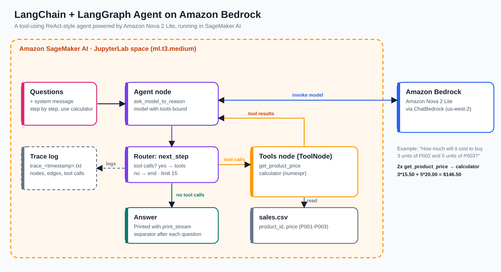
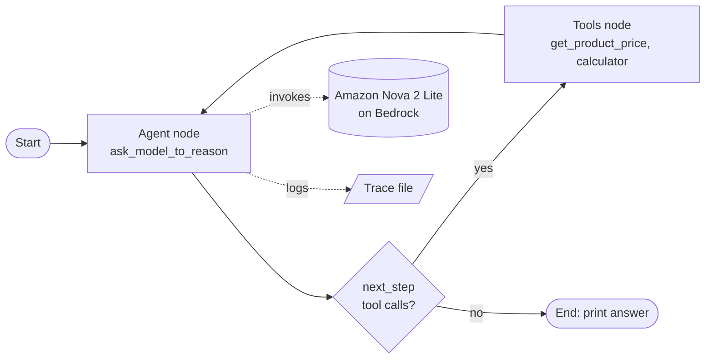
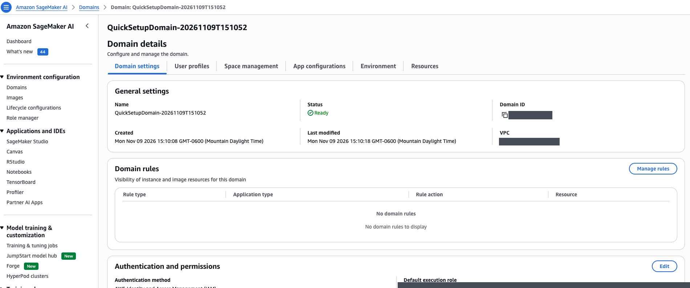
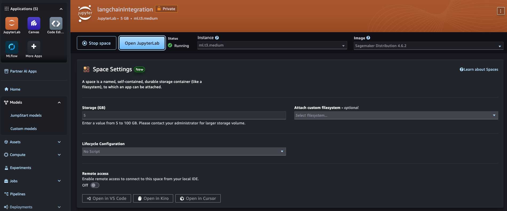
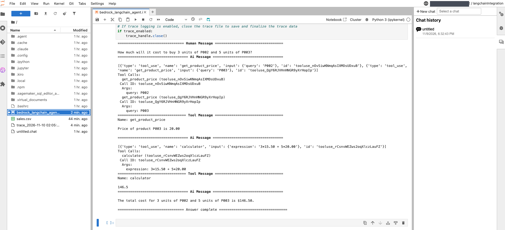
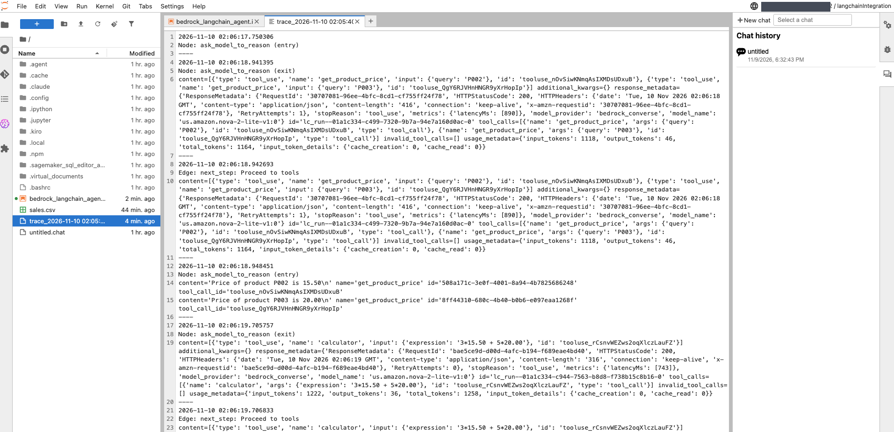

# LangChain Agent on Amazon Bedrock with Amazon Nova 2 Lite

A tool-using AI agent built with **LangChain** and **LangGraph**, powered by **Amazon Nova 2 Lite** on **Amazon Bedrock**, and developed in an **Amazon SageMaker AI** JupyterLab space.

The agent answers questions step by step, looks up product prices from a CSV file, and uses a calculator tool for every calculation instead of guessing. It also writes a trace log of every reasoning step so its behaviour can be debugged.



---

## Summary

This code sets up a LangChain-based agent using Amazon Bedrock's Amazon Nova 2 Lite model. The agent is designed to:

1. **Process Questions:** A list of questions is provided, and the agent answers them step by step, following instructions in the system message.
2. **Use External Tools:** For math-related queries, the calculator tool is used to perform calculations.
3. **Trace Logging:** If enabled, trace data is logged to a file for debugging, with unique file names based on the timestamp.
4. **Display Responses:** The agent's responses are printed after each question, with a separator for clarity.
5. **Recursion Limit:** The agent's reasoning depth is controlled to avoid excessive iterations.

The system handles dynamic question answering, tool usage and logging, ensuring clear, step-by-step agent interaction.

---

## What I Built

| Component | Details |
|---|---|
| **Model** | Amazon Nova 2 Lite (`us.amazon.nova-2-lite-v1:0`) on Amazon Bedrock, region `us-west-2` |
| **Integration** | `ChatBedrock` from `langchain-aws` with a `bedrock-runtime` boto3 client |
| **Agent framework** | LangGraph `StateGraph` with an `agent` node and a `tools` node |
| **Tool 1** | `get_product_price`: looks up a product's price in `sales.csv` |
| **Tool 2** | `calculator`: evaluates math expressions safely with `numexpr` |
| **Control flow** | Conditional edge `next_step` sends the graph to `tools` when the model requests a tool, otherwise to the end |
| **Safety limit** | `recursion_limit = 15` caps reasoning depth |
| **Observability** | Optional trace log file with a timestamped name, recording each node, edge and tool call |
| **Environment** | SageMaker AI JupyterLab space on `ml.t3.medium` |

---

## How the Agent Works



1. The system message tells the model to think step by step, never invent answers, and use the calculator for all maths.
2. The model receives the question with both tools bound to it.
3. If the model asks for a tool, LangGraph runs it and returns the result to the model.
4. The loop repeats until the model answers without a tool call, or the recursion limit is reached.

---

## Step 1: Set up the SageMaker AI environment

I created a SageMaker AI domain with the quick setup and launched a private JupyterLab space named `langchainIntegration` on an `ml.t3.medium` instance with the SageMaker Distribution 4.6.2 image and 5 GB of storage.





---

## Step 2: Build the agent in a notebook

`bedrock_langchain_agent.ipynb` walks through the build:

| Stage | What it does |
|---|---|
| Setup | Installs `numexpr`, `langchain-aws`, `boto3` and `langgraph`, and creates the Bedrock runtime client |
| Model | Creates a `ChatBedrock` model for Nova 2 Lite and tests it with a simple question |
| Data | Writes a small `sales.csv` with three products (P001, P002, P003) |
| Tools | Defines `get_product_price` and `calculator` with the `@tool` decorator |
| Graph | Builds and compiles the LangGraph agent with a conditional edge |
| Helpers | Adds `output_trace`, `consolidate_tool_messages` and `print_stream` |
| Run | Streams the agent's answer to each question with tracing enabled |

```python
@tool
def calculator(expression: str) -> str:
    """Solve a single-line math expression such as "5*4" or "5/4"."""
    return str(numexpr.evaluate(expression.strip(), global_dict={}, local_dict={}))
```

---

## Step 3: Run the agent

Question asked: **"How much will it cost to buy 3 units of P002 and 5 units of P003?"**

The agent called `get_product_price` twice (P002 and P003), passed `3*15.50 + 5*20.00` to the calculator, got `146.5`, and replied with the total.



| Step | What happened |
|---|---|
| 1 | Model requested two `get_product_price` calls in parallel |
| 2 | Tools returned 15.50 for P002 and 20.00 for P003 |
| 3 | Model called `calculator` with `3*15.50 + 5*20.00` |
| 4 | Calculator returned `146.5` |
| 5 | Final answer: **$146.50** |

---

## Step 4: Inspect the trace log

With `trace_enabled = True`, every run creates a file such as `trace_2026-11-10 02:05:40.txt`. It records each node and edge with a timestamp, the model response and the tool messages. In my run the first model call took about 890 ms and used 1,164 tokens, and the second took about 743 ms and used 1,258 tokens.



---

## Try More Questions

The notebook includes commented-out questions you can enable:

- How many units of P010 can I buy with $200?
- Can I buy three units of P003 with $200? If not, how much more should I spend?
- Prices have gone up by 8%. How many units of P003 could I have purchased before the increase with $140, and how many now?

---

## Getting Started

1. Clone this repository
   ```bash
   git clone https://github.com/oveskhan86/<your-repo-name>.git
   ```
2. In the AWS console, enable access to Amazon Nova 2 Lite in Amazon Bedrock for your region.
3. Open Amazon SageMaker AI, create a domain and launch a JupyterLab space.
4. Upload `bedrock_langchain_agent.ipynb`, confirm the region and model ID in the setup cell, and run the cells in order.
5. Check the printed answer and open the generated trace file.

> Make sure the SageMaker execution role is allowed to invoke Bedrock models. Keep account IDs and credentials out of the repository.

---

## Clean Up

Stop the JupyterLab space when you finish, and delete the space and domain if you no longer need them.

---

## Skills Demonstrated

`Agentic AI` · `LangChain` · `LangGraph` · `Amazon Bedrock` · `Amazon Nova` · `Tool calling` · `Prompt design` · `Amazon SageMaker AI` · `Observability and tracing` · `Python`

---

## Author

**Oves Khan** · AI Engineer
[LinkedIn](https://www.linkedin.com/in/oves-khan) · [GitHub](https://github.com/oveskhan86)
